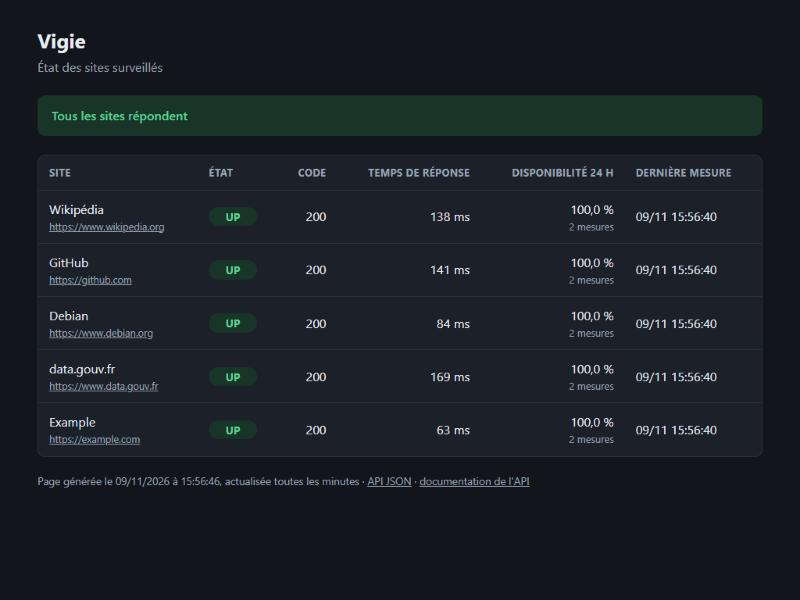

# Vigie

[](https://github.com/LamaJoker/vigie/actions/workflows/ci.yml)

> Service de surveillance de sites web : il vérifie régulièrement que des sites répondent, garde l'historique de leurs temps de réponse, publie une page de statut et envoie une alerte quand un site tombe.

**Statut : en construction (semaine 7 sur 14).** Version actuelle : une sonde, une base PostgreSQL, une API, une page de statut et des alertes Discord, en conteneurs Docker, vérifiés et publiés par GitHub Actions.



## Pourquoi ce projet

Vigie est mon projet de formation au métier de DevOps. L'application est volontairement simple : l'essentiel du travail porte sur la chaîne qui la construit, la teste, la déploie et la supervise, comme en entreprise.

## Méthode de travail

Le projet est réalisé avec un assistant IA de programmation (Claude, d'Anthropic), que je supervise :

- je fixe les objectifs de chaque étape et je valide les choix techniques ;
- l'assistant réalise le travail et propose chaque changement dans une pull request, avec ses explications ;
- je relis, je pose mes questions et je décide de fusionner ou non.

Les commits écrits par l'assistant portent la mention `Co-Authored-By: Claude`.

## Suivre l'évolution

- La [feuille de route](ROADMAP.md) liste les 14 étapes et ce qui est terminé.
- Un [compte rendu par semaine](docs/semaines/) explique ce qui a été fait, pourquoi, comment le vérifier, et le temps passé.
- Les [pull requests](https://github.com/LamaJoker/vigie/pulls?q=is%3Apr) montrent chaque changement et sa validation.

## Ce que Vigie fera

- Tester une liste de sites à intervalle régulier (code HTTP, temps de réponse).
- Enregistrer les résultats dans une base de données.
- Afficher une page de statut : sites en ligne, incidents en cours, historique.
- Envoyer une alerte (Discord, e-mail) quand un site ne répond plus, puis quand il revient.

## Démarrage rapide avec Docker

Prérequis : Docker et Docker Compose.

```bash
make docker-demarrer   # construit l'image, crée le mot de passe de la base, lance tout
make docker-etat       # les 3 services et leurs contrôles de santé
```

La page de statut est sur http://localhost:8000. La pile contient trois services :

| Service | Rôle |
|---|---|
| `base` | PostgreSQL 18, sans port publié : seuls les autres conteneurs la joignent |
| `api` | page de statut et API, publiée uniquement sur la machine (127.0.0.1) |
| `sonde` | teste les sites toutes les 5 minutes (`VIGIE_INTERVALLE`) et envoie les alertes |

Un service `init-db` crée les tables au démarrage, puis s'arrête. La liste des sites (`config/vigie.toml`) est lue depuis la machine : on la modifie sans reconstruire l'image. `make docker-arreter` arrête tout et garde les données. Pour les effacer aussi : `docker compose down --volumes`.

Les conteneurs tournent sans droits root, avec un système de fichiers en lecture seule et sans aucune capacité Linux.

## Utilisation sans Docker

Prérequis : Linux avec Python 3.12 ou plus récent, `make`, le module `venv` et PostgreSQL (sur Ubuntu : `sudo apt install python3-venv make postgresql`).

```bash
make installer     # crée l'environnement virtuel .venv et installe Vigie
make db-demarrer   # lance une base PostgreSQL de développement dans .pgdata/
make sonder        # teste les sites de config/vigie.toml et enregistre les résultats
make serveur       # page de statut sur http://127.0.0.1:8000
make db-arreter    # arrête la base de développement
```

La base de développement n'ouvre aucun port réseau : elle n'est joignable que par un fichier socket dans `.pgdata/`, et elle ne tourne que lorsqu'on la démarre.

### API

| Adresse | Contenu |
|---|---|
| `/` | page de statut |
| `/api/sites` | état de chaque site, en JSON |
| `/api/sites/historique?url=…&limite=50` | derniers résultats d'un site |
| `/api/incidents?limite=20` | derniers incidents (pannes), en cours ou terminés |
| `/sante` | l'application et sa base répondent-elles ? (code 503 si la base est injoignable) |
| `/docs` | documentation interactive de l'API |

### Alertes

Quand un site échoue plusieurs fois de suite (2 par défaut, réglable dans `[alertes]` de `config/vigie.toml`), Vigie ouvre un **incident** et envoie **une** alerte. Quand le site revient, elle ferme l'incident et envoie une alerte de rétablissement, avec la durée de la panne. Rien entre les deux : pas de spam.

Les alertes partent sur Discord. L'adresse du webhook est un secret : elle se met dans un fichier `.env`, jamais commité.

```bash
cp .env.exemple .env      # puis y coller l'adresse du webhook Discord
make tester-alerte        # envoie un message d'essai
```

Sans webhook, les alertes s'affichent seulement dans le terminal. Une alerte que Discord n'a pas pu recevoir est renvoyée au passage suivant. Les alertes ont besoin de la base de données, qui se souvient des incidents en cours.

### La sonde en ligne de commande

Exemple de résultat :

```
UP   200    194 ms  Wikipédia (https://www.wikipedia.org)
UP   200    250 ms  GitHub (https://github.com)
DOWN ---   2001 ms  Mon site (https://mon-site.example)  [pas de réponse en 2 s]
```

Chaque résultat est aussi ajouté à `~/.local/state/vigie/sondes.jsonl`, un objet JSON par ligne :

```json
{"date": "2026-11-09T15:46:16+01:00", "nom": "Example", "url": "https://example.com", "etat": "UP", "code": 200, "duree_ms": 99, "erreur": null}
```

Quand une base est indiquée (`--base` ou variable `VIGIE_DATABASE_URL`), les résultats y sont aussi enregistrés. L'adresse de la base n'est jamais écrite dans le code ni dans la configuration, parce qu'elle peut contenir un mot de passe.

La commande sort avec le code `0` si tous les sites répondent, `1` si au moins un est en panne, `2` en cas d'erreur (configuration invalide, base injoignable…).

### Configuration

Les sites et les réglages sont dans [config/vigie.toml](config/vigie.toml) :

```toml
[sonde]
delai = 10       # secondes accordées à chaque site, redirections comprises
paralleles = 10  # nombre de sites testés en même temps

[[sites]]
nom = "Wikipédia"
url = "https://www.wikipedia.org"
```

Les variables d'environnement `VIGIE_CONFIG` et `VIGIE_LOG` remplacent les chemins par défaut, tout comme les options `--config` et `--log` de `vigie sonder`.

### Vérifier le code

```bash
make tests          # 138 tests Python (pytest) et 17 tests Bash (bats)
make lint           # style et qualité : ruff pour Python, ShellCheck pour Bash
make lint-docker    # Dockerfile (hadolint) et compose.yaml
make tests-docker   # essai de bout en bout de la pile, dans un projet jetable
make ci             # tout ce que vérifie l'intégration continue, en local
```

### Intégration continue

À chaque pull request et à chaque modification de `main`, [GitHub Actions](https://github.com/LamaJoker/vigie/actions) lance automatiquement les mêmes vérifications ([.github/workflows/ci.yml](.github/workflows/ci.yml)) :

| Étape | Contenu |
|---|---|
| Style et analyse | ruff, ShellCheck, hadolint, validation de `compose.yaml` |
| Tests Python | pytest avec PostgreSQL, sur Python 3.12 et 3.14, couverture d'au moins 95 % exigée |
| Tests Bash | bats |
| Image et essai | construction de l'image et essai de bout en bout de toute la pile |
| Publication | sur `main` seulement : l'image testée est publiée sur GitHub Container Registry |

L'image publiée se récupère avec `docker pull ghcr.io/lamajoker/vigie:latest`.

Les tests de la base lancent leur propre PostgreSQL jetable, détruit à la fin. Les tests Bash demandent `bats` et ShellCheck : `sudo apt install bats shellcheck`.

### Version Bash (semaine 2)

La première version, un script Bash, reste disponible :

```bash
./sonde/vigie.sh             # teste les sites de sonde/sites.txt
./sonde/installer-cron.sh    # la lance toutes les 5 minutes (--retirer pour l'enlever)
```

## Compétences travaillées

| Domaine | Outils |
|---|---|
| Système | Linux (Ubuntu sous WSL2), Bash |
| Code | Python, FastAPI, PostgreSQL, pytest |
| Conteneurs | Docker, Docker Compose |
| Intégration et déploiement continus | GitHub Actions |
| Sécurité | Trivy, Dependabot, gestion des secrets |
| Infrastructure as code | Terraform, Ansible |
| Orchestration | Kubernetes (k3d), Helm, Argo CD |
| Supervision | Prometheus, Grafana, Loki |

## Organisation du dépôt

```
vigie/
├── README.md         ce fichier
├── ROADMAP.md        feuille de route sur 14 semaines
├── Makefile          raccourcis : installer, tests, lint, sonder, docker-demarrer...
├── Dockerfile        image de Vigie, en deux étapes, sans root
├── compose.yaml      la pile complète : base, API, sonde
├── .dockerignore     ce qui n'entre jamais dans l'image (secrets, tests...)
├── pyproject.toml    description du paquet Python et de ses dépendances
├── .env.exemple      modèle du fichier des secrets (.env, jamais commité)
├── config/           configuration de la sonde (sites, délais)
├── src/vigie/        le code Python : sonde, base de données, alertes, API, page de statut
├── sonde/            la version Bash et son installation cron
├── tests/
│   ├── python/       tests pytest
│   ├── bash/         tests bats et serveur HTTP de test
│   └── docker/       essai de bout en bout de la pile Docker
├── .github/          intégration continue (workflows/ci.yml) et modèle de pull request
└── docs/
    ├── semaines/     un compte rendu par semaine
    └── images/       captures d'écran
```

## Conventions

Chaque changement passe par une branche et une pull request avant d'arriver sur `main`.

Les messages de commit suivent le format [Conventional Commits](https://www.conventionalcommits.org/fr/v1.0.0/) :

| Préfixe | Usage |
|---|---|
| `feat:` | nouvelle fonctionnalité |
| `fix:` | correction d'un bug |
| `docs:` | documentation, comptes rendus |
| `test:` | tests |
| `ci:` | intégration continue |
| `chore:` | maintenance (dépendances, configuration) |

Exemple : `docs: compte rendu de la semaine 1`
