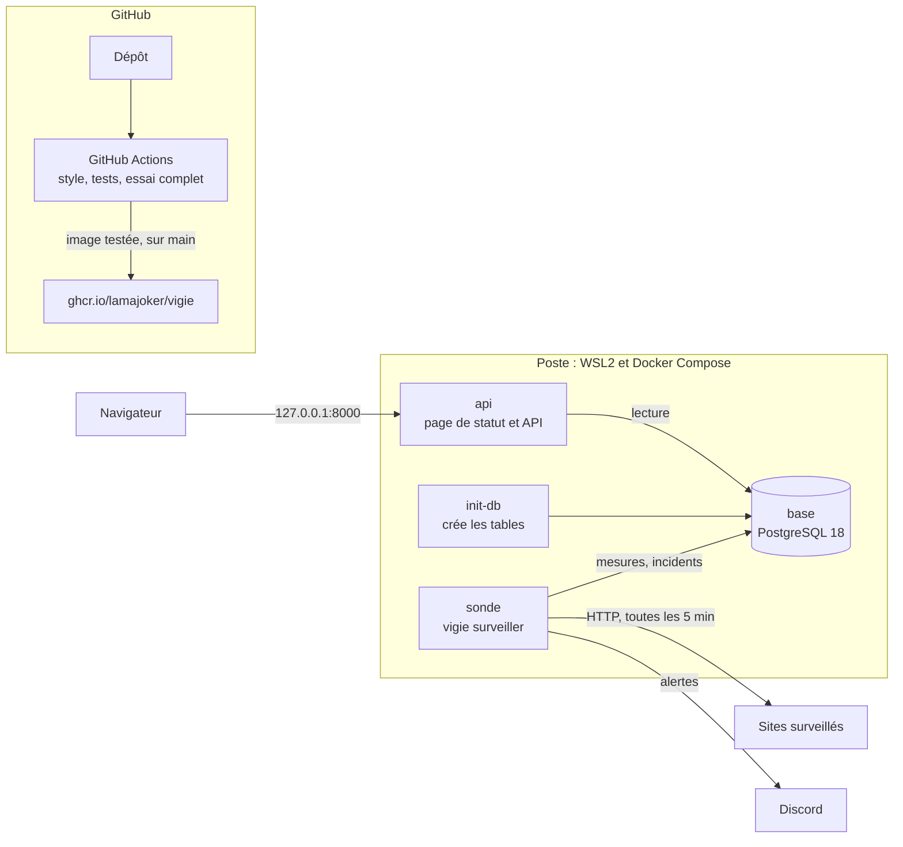
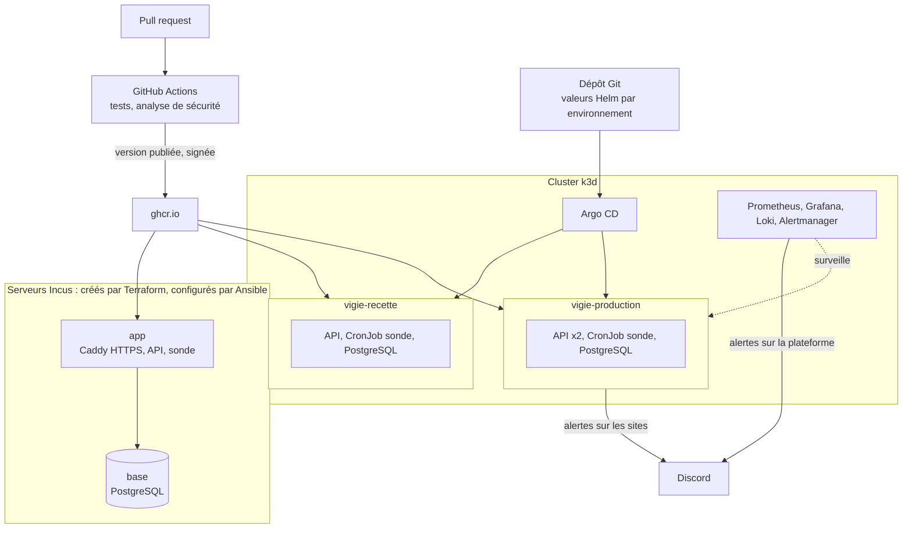

# Architecture

## Aujourd'hui (étape 7)

Vigie tourne en conteneurs sur le poste de développement, avec Docker Compose. Chaque modification passe par GitHub Actions, qui teste puis publie l'image.

| Élément | Rôle | Exposition |
|---|---|---|
| `sonde` | teste les sites, enregistre les mesures, ouvre et ferme les incidents, envoie les alertes | aucune |
| `api` | page de statut, API JSON, point de contrôle `/sante` | `127.0.0.1:8000` seulement |
| `init-db` | crée les tables puis s'arrête | aucune |
| `base` | PostgreSQL 18, données dans un volume | aucune, réseau interne seulement |

## Cible (étape 14)

La même application, déployée de deux façons pour couvrir les deux mondes de l'exploitation : des serveurs configurés par Ansible, et un cluster Kubernetes piloté par Git.

## Ici et en entreprise

Le projet tourne en local, pour 0 € ([décision 0005](decisions/0005-tout-en-local-sans-frais.md)). Les gestes sont ceux de l'entreprise, seule la cible change. Ce tableau sera complété à chaque étape.

| Ici | En entreprise |
|---|---|
| Docker Compose sur le poste | Docker Compose sur un serveur, ou un orchestrateur |
| GitHub Actions et ghcr.io | Pareil, ou GitLab CI et un registre interne |
| Base PostgreSQL dans un conteneur, avec un volume | Base gérée par le fournisseur cloud, ou par un opérateur Kubernetes |
| Conteneurs système Incus (étape 9) | Machines virtuelles d'un cloud |
| État Terraform local (étape 9) | État dans un stockage distant, avec verrou |
| Cluster k3d (étape 11) | Kubernetes géré (EKS, GKE, AKS...) |
