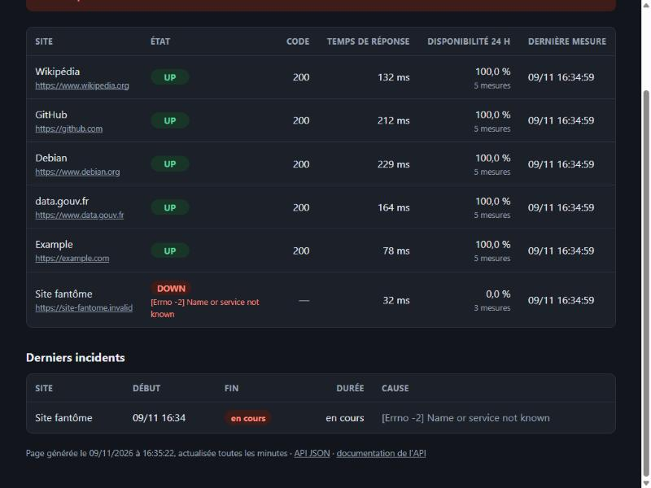

# Étape 5 : alertes

**Date :** 9 novembre 2026
**Statut :** livrée en pull request

## Objectif

Prévenir quelqu'un quand un site tombe, et quand il revient, sans le noyer sous les messages.



## Ce qui a été fait

### Les incidents

Un **incident** est une panne d'un site, de son début à son rétablissement. Il est stocké dans une nouvelle table `incidents` :

- **N échecs consécutifs avant d'ouvrir un incident** (`echecs_avant_alerte`, 2 par défaut). Un raté isolé (coupure réseau d'une seconde, redémarrage d'un serveur) ne réveille personne. On appelle ça éviter les *fausses alertes* ou le *flapping*.
- **La panne commence au premier échec**, pas au moment où on la confirme : la durée affichée est la vraie durée.
- **Un seul incident ouvert par site, garanti par la base** : un index unique partiel (`UNIQUE … WHERE fin IS NULL`) rend impossible un deuxième incident ouvert pour le même site, même si deux programmes essayaient en même temps.
- **Le retour du site ferme l'incident.** Une nouvelle panne plus tard ouvre un nouvel incident.

### Les alertes sur Discord

- **Deux alertes par incident, jamais plus** : 🔴 « Panne » (avec la cause) et 🟢 « Rétabli » (avec la durée de la panne).
- **Une alerte non reçue est renvoyée.** Chaque incident porte deux cases, « alerte de panne envoyée » et « alerte de rétablissement envoyée ». Tant que Discord n'a pas confirmé, la case reste vide et l'alerte repart au passage suivant. C'est le principe de la livraison « au moins une fois ».
- **Discord surchargé (code 429)** : on attend le délai qu'il demande (5 secondes au plus), puis on réessaie une fois.
- **Paquets de 10 alertes** au plus par message (limite de Discord).
- **Aucune mention** (`@everyone`…) ne peut partir d'un nom de site ou d'un message d'erreur.
- **`vigie tester-alerte`** envoie un message d'essai pour vérifier la configuration.

### Le secret : l'adresse du webhook

L'adresse d'un webhook Discord permet à n'importe qui d'écrire dans le salon. C'est donc un **secret**, traité comme tel :

- elle se règle dans la variable d'environnement `VIGIE_DISCORD_WEBHOOK`, chargée par le `Makefile` depuis un fichier **`.env` ignoré par Git**. Le dépôt contient seulement le modèle vide `.env.exemple` ;
- **elle n'est jamais affichée**, même en cas d'erreur. Les messages d'erreur de la bibliothèque HTTP contiennent l'adresse appelée : on n'en garde que le type d'erreur. Deux tests le vérifient.

### Page de statut et API

- Une section « Derniers incidents » sur la page (en cours ou terminés, avec la durée et la cause).
- `GET /api/incidents` pour les autres programmes.
- Seuls les sites encore surveillés sont affichés : un site retiré de la configuration ne laisse pas une panne « en cours » pour toujours.

### Les tests

**128 tests pytest** (99 % du code couvert), dont 46 nouveaux :

- **incidents** (19 tests, sur une vraie base) : un échec isolé n'ouvre rien, deux échecs ouvrent un incident, une longue panne reste un seul incident, le retour le ferme, la base refuse deux incidents ouverts, durées lisibles ;
- **Discord** (11 tests, faux Discord) : format des messages, paquets de 10, code 429 puis nouvel essai, refus, Discord injoignable, adresse secrète jamais révélée ;
- **scénarios complets** (6 tests) : un vrai site local qu'on fait tomber puis revenir, et un faux Discord qui compte les messages. On vérifie qu'il en reçoit **exactement deux**. Si Discord est en panne, l'alerte repart au passage suivant ;
- **configuration, API et page** (10 tests).

### Un piège évité en route

Deux mesures enregistrées **dans la même seconde** n'avaient pas d'ordre garanti. La base pouvait alors prendre un ancien succès pour la dernière mesure, et rater une panne. Dans la réalité, les passages sont espacés de plusieurs minutes, mais les tests, eux, enchaînent les passages très vite. Les requêtes départagent maintenant les mesures par leur numéro d'enregistrement.

## Essai réel

Configuration d'essai : les 5 vrais sites et un « site fantôme » à une adresse qui n'existe pas.

| Passage | Site fantôme | Alerte |
|---|---|---|
| 1 | `DOWN` (adresse introuvable) | aucune : un seul échec |
| 2 | `DOWN` | « Alerte : Site fantôme est en panne » |
| 3 | `DOWN` | aucune : panne déjà signalée |

La page de statut affiche le bandeau rouge, la disponibilité à 0 % et l'incident « en cours » (capture ci-dessus). Les données d'essai ont ensuite été effacées de la base de développement.

**Pas encore testé avec le vrai Discord** : il faut créer un webhook dans un serveur Discord (voir `.env.exemple`), puis lancer `make tester-alerte`.

## Limites connues

- **Un seul canal d'alerte** (Discord). L'e-mail ou d'autres messageries pourraient s'ajouter sur le même modèle.
- **Les alertes ont besoin de la base** : sans elle, impossible de savoir si une panne est déjà signalée.
- **Pas de « maintenance prévue »** : une coupure volontaire déclenche quand même une alerte.

## Comment vérifier

```bash
cd ~/vigie
make installer && make tests && make lint
make db-demarrer
cp .env.exemple .env      # y coller l'adresse d'un webhook Discord
make tester-alerte
make sonder
make db-arreter
```

## Vocabulaire de l'étape

| Terme | Sens |
|---|---|
| Incident | Une panne, de son début à son rétablissement |
| Fausse alerte, *flapping* | Alerte déclenchée par un raté isolé, ou état qui oscille sans arrêt |
| Webhook | Adresse sur laquelle un programme envoie un message à un service (ici Discord) |
| Secret | Donnée qui donne un accès (mot de passe, jeton, webhook) : jamais dans le code ni dans Git |
| `.env` | Fichier local des secrets et réglages, ignoré par Git |
| Index unique partiel | Règle de la base : « une seule ligne de ce type », limitée à certaines lignes |
| Livraison « au moins une fois » | Un message est renvoyé tant que sa réception n'est pas confirmée |
| Code 429 | « Trop de requêtes » : le service demande de patienter |

## Temps de supervision

| Jour | Activité | Durée |
|---|---|---|
| Lun. 9/11 | Relecture de la pull request de l'étape 5 | |

**Total :** h
