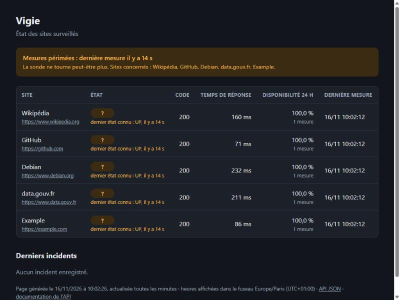

# Étape 8 : durcissement

**Date :** à partir du 10 novembre 2026 (lot 8.1 : 10-11 novembre ; lot 8.2 : 16 novembre)
**Statut :** en cours (lots 8.1 et 8.2 livrés)
**Lots :** [#9](https://github.com/LamaJoker/vigie/issues/9) 8.1 · [#10](https://github.com/LamaJoker/vigie/issues/10) 8.2 · [#11](https://github.com/LamaJoker/vigie/issues/11) 8.3 · [#12](https://github.com/LamaJoker/vigie/issues/12) 8.4 · [#13](https://github.com/LamaJoker/vigie/issues/13) 8.5 · [#14](https://github.com/LamaJoker/vigie/issues/14) 8.6

## Objectif

Avant de déployer Vigie sur des serveurs et dans un cluster, la rendre fiable, puis sécuriser la chaîne qui la construit. Les défauts traités ici viennent de la revue du 10/11/2026, où chacun a été reproduit.

## Lot 8.1 : une sonde qui ne tombe pas

### Le problème

Une seule adresse mal écrite dans la configuration suffisait à arrêter toute la surveillance. Avec `https://example.com:99999`, la configuration était acceptée, puis le passage entier plantait : plus aucun site n'était mesuré. Dans le conteneur, la sonde aurait redémarré en boucle. D'autres cas produisaient une trace Python illisible au lieu d'un message clair.

### Ce qui a été fait

**1. Les adresses sont vérifiées au chargement de la configuration.** Une adresse est refusée, avec un message qui dit pourquoi et le code de sortie 2, si :

| Cas | Exemple | Avant |
|---|---|---|
| port hors limites ou non numérique | `https://example.com:99999` | plantage de tout le passage |
| adresse IPv6 mal refermée | `http://[::1` | trace Python |
| espace ou caractère invisible | `https://exa mple.com`, octet nul | `DOWN` à chaque passage, ou plantage |
| pas de nom d'hôte | `https://:443/` | acceptée |
| plus de 2 000 caractères | une adresse de 70 000 caractères | acceptée |

Le message ne recopie jamais une adresse géante en entier. Un fichier qui n'est pas en UTF-8, ou un dossier à la place du fichier, donne aussi un message clair.

*Pourquoi refuser au chargement plutôt que noter le site `DOWN` ?* Une adresse mal écrite est une erreur de configuration, pas une panne du site. La noter `DOWN` déclencherait une fausse alerte et laisserait croire que le site est tombé.

**2. Une erreur imprévue n'arrête plus les autres sites.** La sonde attrapait déjà les erreurs réseau connues. Désormais, toute autre erreur (un bug, un cas limite d'une bibliothèque) donne un résultat `DOWN` avec la cause « erreur interne (type de l'erreur) ». La trace complète part dans le journal pour qu'on puisse corriger, et les autres sites sont mesurés normalement.

**3. La sonde ne télécharge plus le corps des pages.** Elle lit le code et les en-têtes, puis ferme la connexion (lecture « en flux »). Seul le code compte pour savoir si un site répond. Le reste coûtait du temps, de la mémoire et de la bande passante, et une adresse vers un gros fichier aurait pu bloquer la sonde jusqu'au délai maximal. **Conséquence à connaître :** le temps mesuré s'arrête maintenant à la réception des en-têtes. Il est plus court qu'avant et pas directement comparable.

**4. La boucle de surveillance résiste aux erreurs, avec un garde-fou.** `vigie surveiller` continue après une erreur imprévue d'un passage, et garde sa trace. Mais après **5 erreurs imprévues de suite**, elle s'arrête avec le code 1. Un problème permanent ne doit pas tourner en silence : en s'arrêtant, la sonde laisse Docker ou Kubernetes la relancer, et le compteur de redémarrages rend le problème visible.

**5. Un site retiré de la configuration ne laisse plus d'incident « en cours ».** Son incident est fermé avec le motif « site retiré de la surveillance », sans alerte, et une alerte encore en attente pour lui ne part plus. La table des incidents gagne une colonne `motif_fin`. Rejouer le schéma l'ajoute aussi aux bases existantes, comme le vérifie un test.

### Les tests : d'abord rouges, puis verts

**22 nouveaux tests** (164 au total, 99 % du code couvert). Chacun a d'abord été lancé contre le code d'avant le lot, **où les 22 échouent**. C'est la preuve qu'ils détectent vraiment les défauts. Après la correction, ils passent tous.

Un test a dû être renforcé en route. Le test « retirer un site en panne » vérifiait seulement qu'aucune alerte ne partait. Il passait aussi sur l'ancien code, qui n'en envoyait pas non plus, tout en laissant l'incident ouvert pour toujours. Il vérifie maintenant que l'incident est fermé. Leçon : **un test qu'on n'a jamais vu échouer ne prouve rien.**

Le test de la page géante utilise un faux site qui annonce 50 Mo et les envoie au compte-gouttes. Il lui faudrait plus de 40 secondes pour tout envoyer : la sonde répond `UP` en moins d'une seconde.

### Essais réels

**Port impossible au milieu de vrais sites**, ancien code puis nouveau :

```
=== ANCIEN code
    | OverflowError: connect(): port must be 0-65535.
code de sortie : 1          (aucun site mesuré)
=== NOUVEAU code
vigie: site n°3 : adresse http ou https valide attendue (mal formée : Port out of range 0-65535), reçu 'https://example.com:99999'
code de sortie : 2
```

**Adresses étranges mais syntaxiquement valides**, glissées entre de vrais sites : chacune est notée `DOWN`, et tous les vrais sites sont mesurés.

```
UP   200    121 ms  Wikipédia (https://www.wikipedia.org)
UP   200     78 ms  GitHub (https://github.com)
DOWN ---     48 ms  Fantôme (https://site-fantome.invalid)  [[Errno -2] Name or service not known]
DOWN 403     81 ms  Port zéro (https://example.com:0/)
DOWN ---      3 ms  Points doubles (https://a..b.example/)  [[Errno -2] Name or service not known]
UP   200     94 ms  Debian (https://www.debian.org)
```

L'adresse au port 0 obtient une réponse 403 du serveur. Ce port n'a pas de sens, et on pourrait le refuser au chargement : piste notée, sans urgence, puisque le site est bien `DOWN`.

**Temps mesuré**, médiane de 3 passages sur les 5 sites de la configuration :

| Site | Corps entier (avant) | En-têtes seulement (après) |
|---|---|---|
| Wikipédia | 204 ms | 127 ms |
| GitHub | 143 ms | 89 ms |
| Debian | 177 ms | 96 ms |
| data.gouv.fr | 227 ms | 123 ms |
| Example | 83 ms | 79 ms |

### Limites connues

- Les adresses étranges mais valides (`a..b.example`, port 0) ne sont pas refusées au chargement. Elles donnent `DOWN`, sans planter.
- La règle « 5 erreurs imprévues de suite » est fixe dans le code. Elle n'a pas de raison d'être réglée tant qu'aucune erreur imprévue n'est connue.
- La version Bash de la sonde (étape 2) n'a pas reçu ces corrections : elle est gardée comme historique.

### Vocabulaire du lot

| Terme | Sens |
|---|---|
| Validation en entrée | Refuser une donnée invalide dès qu'elle arrive, avec un message clair, plutôt que de la laisser casser le programme plus loin |
| Filet de sécurité | Dernier recours qui attrape toute erreur imprévue pour limiter les dégâts, et la trace pour qu'on la corrige |
| Lecture en flux (*streaming*) | Lire une réponse au fur et à mesure, et pouvoir s'arrêter avant la fin |
| Garde-fou | Règle qui arrête un programme quand une erreur se répète, pour qu'elle ne passe pas inaperçue |
| Test rouge puis vert | Écrire le test, le voir échouer sur le code fautif, puis corriger jusqu'à ce qu'il passe |
| Régression | Défaut qui revient après avoir été corrigé ; un test qui le reproduit l'en empêche |

### Parcours du superviseur

Environ 30 minutes.

#### À lancer

```bash
cd ~/vigie && git switch main && git pull
make installer
make tests                     # 164 tests Python et 17 tests Bash
.venv/bin/vigie sonder         # les 5 sites de config/vigie.toml
```

#### À casser

1. Ouvre `config/vigie.toml` et remplace l'adresse de GitHub par `https://github.com:99999`.
2. Lance `.venv/bin/vigie sonder`, puis `echo $?`. Observe le message, qui désigne le site fautif, et le code de sortie 2.
3. Essaie aussi `https://git hub.com` (avec une espace), puis `http://[::1`.
4. Remets le fichier dans son état d'origine : `git checkout config/vigie.toml`.

#### Cinq questions

1. Pourquoi refuser une adresse mal écrite au chargement, plutôt que de la noter `DOWN` ?
   <details><summary>Réponse</summary>

   C'est une erreur de configuration, pas une panne du site. La noter `DOWN` enverrait une fausse alerte et ferait croire que le site est tombé. La refuser tout de suite, avec le numéro du site et la raison, permet de corriger en quelques secondes. Voir `probleme_url` dans `src/vigie/config.py`.
   </details>

2. Que se passe-t-il si une erreur imprévue survient en testant un site ?
   <details><summary>Réponse</summary>

   Le site est noté `DOWN` avec la cause « erreur interne (type) », la trace complète part dans le journal, et les autres sites sont mesurés normalement. Voir le dernier `except` de `sonder_site` dans `src/vigie/sonde.py`.
   </details>

3. Pourquoi `vigie surveiller` s'arrête-t-il après 5 erreurs imprévues de suite, au lieu de continuer ?
   <details><summary>Réponse</summary>

   Une erreur qui se répète cache un problème permanent. En s'arrêtant avec le code 1, la sonde laisse l'orchestrateur la relancer, et le nombre de redémarrages devient visible : `docker compose ps` aujourd'hui, l'état `CrashLoopBackOff` dans Kubernetes demain. Continuer en silence masquerait la panne.
   </details>

4. Pourquoi la sonde ne télécharge-t-elle plus le corps des pages, et quelle conséquence cela a-t-il ?
   <details><summary>Réponse</summary>

   Seul le code HTTP dit si un site répond. Télécharger la page coûtait du temps, de la mémoire et de la bande passante, et une adresse vers un gros fichier pouvait bloquer la sonde. Conséquence : le temps mesuré s'arrête à la réception des en-têtes. Il est plus court qu'avant, environ 35 à 45 % de moins sur les gros sites, et pas directement comparable. Le journal des versions le signale.
   </details>

5. Comment être sûr qu'un test détecte vraiment le défaut qu'il prétend couvrir ?
   <details><summary>Réponse</summary>

   En le voyant échouer sur le code fautif avant la correction. Ici, les 22 nouveaux tests ont été lancés contre le code d'avant le lot : les 22 échouent. Un test qui passait aussi sur l'ancien code a ainsi été repéré, puis renforcé.
   </details>

## Lot 8.2 : une page qui ne ment pas

### Le problème

Deux défauts trouvés à la revue du 10/11 :

- **Dans un conteneur, la page affichait les heures en UTC, sans le dire.** Vérifié : le conteneur indiquait 09:11 quand il était 10:11 à Paris. Un lecteur français se trompait d'une heure sur le début d'un incident.
- **Des données périmées s'affichaient en vert.** Si la sonde s'arrêtait, la page continuait d'afficher « Tous les sites répondent » avec la dernière mesure connue, même vieille de plusieurs heures. Une page de statut qui ment par omission, c'est pire que pas de page du tout.

### Ce qui a été fait

**1. Un fuseau horaire d'affichage réglable.** Dans `config/vigie.toml` : `[affichage] fuseau = "Europe/Paris"`. Un fuseau inconnu est refusé au chargement. La valeur par défaut est `UTC`, explicite et sans surprise. La page dit dans quel fuseau elle affiche, et chaque heure est aussi écrite dans une balise `<time datetime="…">` en UTC, lisible par une machine. La dépendance `tzdata` fournit la base des fuseaux, même dans une image qui n'en contient pas.

*Pourquoi régler le fuseau dans l'application plutôt que celui du conteneur ?* Le conteneur, les journaux et la base restent en UTC, ce qui est la règle en exploitation : une seule référence de temps, pas de piège au changement d'heure. Seul l'affichage destiné à un humain est converti.

**2. L'intervalle de la sonde entre dans la configuration.** `[sonde] intervalle = 300`. La sonde s'en sert pour rythmer ses passages, et l'API pour juger de la fraîcheur des mesures : les deux doivent donc partager la même valeur. Ordre de priorité : l'option `--intervalle`, puis la variable `VIGIE_INTERVALLE`, puis le fichier. `0` est désormais refusé.

**3. Les mesures périmées sont signalées.** Une mesure est périmée au-delà de **3 intervalles**, soit 15 minutes avec le réglage par défaut : la sonde a manqué au moins deux passages.
- `/api/sites` renvoie pour chaque site `age_secondes` et `perime`.
- La page affiche un **bandeau orange** : « Mesures périmées : dernière mesure il y a 47 min. La sonde ne tourne peut-être plus. »
- Un site périmé affiche « ? » avec son dernier état connu, au lieu d'un `UP` vert trompeur.
- Une vieille panne n'est plus présentée comme une panne actuelle. Une panne récente reste en rouge, en premier.



*Capture réelle, 16/11/2026 : un passage de sonde, puis la page servie avec un intervalle de 2 s. Au bout de 14 s sans nouvelle mesure, les 5 sites sont signalés. Avant le lot 8.2, cette même situation s'affichait en vert.*

**4. La sonde a un contrôle de santé.** `vigie sante-sonde` répond `0` si une mesure récente existe en base, `1` sinon. Il sert de contrôle de santé (`healthcheck`) au conteneur de la sonde. Avant, Docker savait seulement si le processus tournait. Il sait maintenant si la sonde **fait son travail** : une sonde qui tourne mais n'enregistre plus rien, par exemple parce que la base est injoignable, devient « unhealthy ».

### Les tests

**46 nouveaux tests** (210 au total, 99 % du code couvert). Lancés contre le code d'avant le lot, les 46 échouent. Pour être exact, beaucoup échouent simplement parce que les réglages `fuseau` et `intervalle` n'existaient pas encore.

Deux choix pour qu'ils prouvent vraiment quelque chose :

- **Les tests d'affichage utilisent le fuseau `Asia/Tokyo`.** S'ils utilisaient `Europe/Paris`, un affichage « à l'heure de la machine » passerait sur ce poste, qui est réglé sur Paris, et échouerait seulement dans la CI, qui est en UTC. Tokyo ne correspond à aucune des deux machines.
- **Un test sur la boucle de surveillance a dû être corrigé.** Il remplaçait l'objet `Event` de tout Python pour compter les attentes, et d'autres composants s'en servaient aussi pendant le test. Il ne remplace plus que celui de `vigie.cli`. Leçon : un remplacement trop large dans un test fausse le résultat.

**L'essai de bout en bout dans Docker** vérifie maintenant trois choses de plus :

1. la page annonce le fuseau `Europe/Paris` et affiche l'heure de Paris ;
2. la sonde est « healthy », devient « unhealthy » quand on arrête la base, puis redevient « healthy » quand la base revient ;
3. une fois la sonde arrêtée, la page passe au bandeau « Mesures périmées » et n'affiche plus de bandeau vert.

### Un réglage de l'essai corrigé en route

Au premier essai, la dernière mesure avait 13 s, alors que la sonde passait toutes les 5 s. L'examen des journaux montre des passages réguliers d'environ 0,3 s : l'écart vient d'un site qui a mis plusieurs secondes à répondre, ce qui est permis jusqu'au délai de 10 s. Avec un intervalle de 5 s, le seuil de péremption n'était que de 15 s : l'essai aurait pu échouer au hasard dans la CI. L'intervalle de l'essai passe à 10 s (seuil de 30 s). En production, avec 5 minutes d'intervalle, la marge est très large.

### Limites connues

- Le seuil de 3 intervalles est fixe dans le code.
- Le seuil ne tient pas compte du délai accordé à chaque site. C'est négligeable avec 5 minutes d'intervalle, mais à surveiller si on réduit beaucoup l'intervalle.
- La page s'actualise toute seule toutes les minutes, mais elle n'avertit pas activement : c'est le rôle de la supervision de la plateforme (étape 13, alerte « sonde muette »).

### Vocabulaire du lot

| Terme | Sens |
|---|---|
| Fuseau horaire | Règle qui donne l'heure locale à partir de l'heure universelle (UTC), changements d'heure compris |
| UTC | Temps universel coordonné : la référence unique, utilisée par les serveurs, les journaux et les bases |
| Donnée périmée | Donnée trop ancienne pour être crue, même si elle était juste au moment de sa mesure |
| Contrôle de santé (*healthcheck*) | Commande lancée régulièrement par Docker ou Kubernetes pour savoir si un service fonctionne vraiment |
| `healthy` / `unhealthy` | État que Docker attribue à un conteneur selon le résultat de son contrôle de santé |

### Parcours du superviseur

Environ 30 minutes.

#### À lancer

```bash
cd ~/vigie && git switch main && git pull
make installer && make tests
make docker-demarrer
make docker-etat             # attendre que « sonde » affiche (healthy)
```

Ouvre ensuite http://localhost:8000 : en bas de page, le fuseau `Europe/Paris` est annoncé, et les heures sont celles de ta montre.

#### À casser

1. Arrête la sonde : `docker compose stop sonde`.
2. Attends 15 minutes (3 intervalles de 5 minutes). Pour aller plus vite, mets `intervalle = 20` dans `config/vigie.toml`, relance avec `docker compose up -d`, attends une minute, puis arrête la sonde. La page passe au bandeau orange dans la minute.
3. Arrête la base : `docker compose stop base`. Après une minute ou deux, `make docker-etat` montre la sonde « unhealthy ». Relance avec `docker compose start base sonde`.
4. Remets tout en ordre : `git checkout config/vigie.toml`, puis `make docker-arreter`.

#### Cinq questions

1. Pourquoi garder le conteneur, les journaux et la base en UTC, et ne convertir que l'affichage ?
   <details><summary>Réponse</summary>

   Une seule référence de temps évite les erreurs de comparaison et les pièges du changement d'heure, par exemple l'heure qui existe deux fois fin octobre. On ne convertit qu'au dernier moment, pour un humain. Voir `zone` dans `src/vigie/api.py`.
   </details>

2. Qu'est-ce qu'une mesure « périmée », et pourquoi 3 intervalles ?
   <details><summary>Réponse</summary>

   Une mesure trop vieille pour être crue. Avec 1 intervalle, le moindre retard d'un passage déclencherait l'alerte. À 3, la sonde a manqué au moins deux passages : ce n'est plus un hasard. Voir `INTERVALLES_AVANT_PEREMPTION` dans `src/vigie/base.py`.
   </details>

3. Pourquoi l'API et la sonde doivent-elles connaître le même intervalle ?
   <details><summary>Réponse</summary>

   La sonde s'en sert pour rythmer ses passages, l'API pour juger la fraîcheur. Si l'API croyait à un intervalle de 5 minutes alors que la sonde passe toutes les heures, toutes les mesures paraîtraient périmées. D'où un seul réglage dans la configuration, et `VIGIE_INTERVALLE` transmis aux deux conteneurs dans `compose.yaml`.
   </details>

4. Quelle différence entre « le conteneur tourne » et « le conteneur est healthy » ?
   <details><summary>Réponse</summary>

   « Il tourne » veut seulement dire que le processus existe. « Healthy » veut dire que son contrôle de santé réussit, c'est-à-dire qu'il fait son travail. Une sonde qui ne peut plus écrire en base tourne toujours, mais n'est plus healthy. Kubernetes ira plus loin à l'étape 11 : il redémarrera ou retirera du trafic un pod en mauvaise santé.
   </details>

5. Pourquoi les tests d'affichage utilisent-ils le fuseau de Tokyo ?
   <details><summary>Réponse</summary>

   Pour ne coïncider avec aucune machine de test. Avec `Europe/Paris`, un code qui affiche l'heure de la machine passerait sur ce poste (réglé sur Paris) sans rien prouver.
   </details>

## Temps de supervision

Rempli par le superviseur.

| Jour | Activité | Durée |
|---|---|---|
| | | |

**Total :** h
