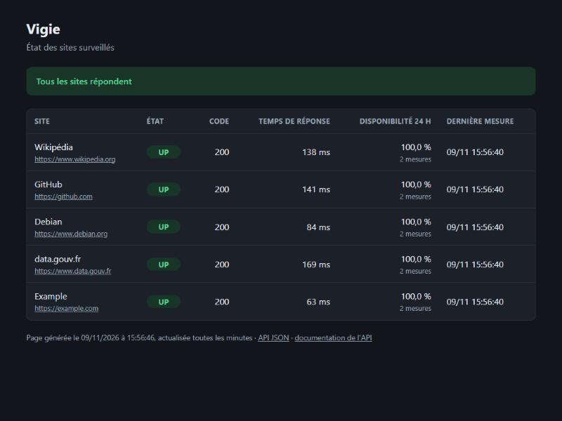

# Semaine 4 : API et base de données

**Date :** 9 novembre 2026 (étape avancée à la demande du superviseur)
**Statut :** livrée en pull request

## Objectif

Garder l'historique des mesures dans une vraie base de données, et le rendre consultable : une API pour les programmes, une page de statut pour les humains.



## Ce qui a été fait

### La base de données PostgreSQL

- **Une table `sondes`** (`src/vigie/schema.sql`) : une ligne par mesure, avec la date et le fuseau horaire, le site, l'état, le code HTTP, le temps de réponse et l'erreur éventuelle.
- **Des contraintes `CHECK`** : la base refuse elle-même un état autre que `UP` ou `DOWN`, un code HTTP impossible ou une durée négative. Les données restent saines même si le code a un bug.
- **Un index sur (site, date)** : les questions fréquentes (« dernier résultat de chaque site », « mesures des dernières 24 heures ») restent rapides quand la table grossit.
- **Des requêtes paramétrées** (`%s`) : les valeurs ne sont jamais collées dans le texte SQL, ce qui empêche les injections SQL.
- **L'adresse de la base vient d'une variable d'environnement** (`VIGIE_DATABASE_URL`), jamais du code ni de la configuration, parce qu'elle peut contenir un mot de passe. C'est une règle de base pour les secrets.
- **`vigie init-db`** crée les tables. On peut le relancer sans risque (`CREATE TABLE IF NOT EXISTS`).

### Une base de développement sans service permanent

Installer PostgreSQL crée d'habitude une base qui démarre avec la machine et écoute sur le réseau. On l'a évité :

- les programmes PostgreSQL sont installés **sans base par défaut** ;
- `make db-demarrer` lance une base propre au projet, dans `.pgdata/`, **joignable uniquement par un fichier socket** (aucun port réseau ouvert) ;
- `make db-arreter` l'arrête. Rien ne tourne quand on ne travaille pas.

### L'API et la page de statut (FastAPI)

| Adresse | Rôle |
|---|---|
| `/` | page de statut : bandeau « tout va bien » ou « N sites en panne », tableau des sites |
| `/api/sites` | même information en JSON, pour d'autres programmes |
| `/api/sites/historique` | derniers résultats d'un site |
| `/sante` | point de contrôle : 200 si l'application et la base répondent, 503 sinon |
| `/docs` | documentation interactive, générée automatiquement par FastAPI |

Choix et raisons :

- **`/sante`** sert aux outils qui surveillent l'application elle-même : Docker (semaine 6) et Kubernetes (semaine 11) l'interrogeront pour savoir si le conteneur va bien.
- **Base injoignable = réponse 503** (« service indisponible ») avec un message clair, au lieu d'une erreur 500 incompréhensible.
- **La page échappe tout le texte affiché** (moteur de modèles Jinja2) : un nom de site piégé avec du code HTML ne peut pas s'exécuter dans le navigateur. Un test le vérifie.
- **La page s'adapte au thème clair ou sombre** et s'actualise toute seule chaque minute.
- **La disponibilité sur 24 heures** est la part des mesures `UP`. C'est l'indicateur le plus regardé en exploitation (on parle de « SLA à 99,9 % »).

### Les tests

**82 tests pytest** (99 % du code couvert), dont 31 nouveaux :

- **la base** (9 tests) sur une **vraie base PostgreSQL jetable** : les tests la créent dans un dossier temporaire au démarrage et la détruisent à la fin. On vérifie le dernier état, la disponibilité sur 24 heures, l'historique, et que les contraintes refusent les données invalides ;
- **l'API et la page** (14 tests) : santé, base injoignable, JSON, historique, paramètres invalides, bandeaux, protection contre l'injection HTML, documentation ;
- **la ligne de commande** (8 tests) : enregistrement en base, base injoignable, `init-db`, lancement du serveur.

Un réglage isole aussi les tests des variables `VIGIE_*` de la machine : un test ne doit jamais écrire dans la vraie base par accident.

## Essai réel

`make db-demarrer`, deux passages de `make sonder`, puis `make serveur` : les 5 sites sont `UP` avec 100 % de disponibilité (capture ci-dessus). `/sante` répond `{"statut": "ok", "base": "ok"}`, l'historique renvoie les mesures, et une adresse inconnue donne bien `404`.

## Limites connues

- **Une connexion à la base par requête web** : simple et suffisant ici. Avec beaucoup de visiteurs, il faudra un « pool » de connexions réutilisées.
- **Le schéma est créé, mais pas encore versionné** : pour le faire évoluer proprement, il faudra un outil de migrations (Alembic, par exemple).
- **La table grossit sans fin** : il faudra purger les vieilles mesures, ou les résumer.
- **Avertissement de dépréciation** dans les tests : la bibliothèque Starlette annonce un changement de client HTTP pour ses outils de test. Rien ne casse aujourd'hui, mais c'est à suivre lors d'une mise à jour.
- **La sonde n'est pas encore lancée automatiquement en continu** : ce sera le rôle des conteneurs (semaine 6).

## Comment vérifier

```bash
cd ~/vigie
make installer
make tests          # 82 tests Python et 17 tests Bash
make lint
make db-demarrer
make sonder
make serveur        # puis ouvrir http://localhost:8000 dans le navigateur
make db-arreter     # après Ctrl+C sur le serveur
```

## Vocabulaire de la semaine

| Terme | Sens |
|---|---|
| PostgreSQL | Base de données relationnelle libre, très répandue en entreprise |
| Schéma | Description des tables et de leurs colonnes |
| Contrainte `CHECK` | Règle que la base impose à chaque ligne |
| Index | Structure qui accélère les recherches dans une table |
| Injection SQL | Attaque qui glisse du code SQL dans une valeur ; les requêtes paramétrées l'empêchent |
| API | Interface qui permet à des programmes d'échanger des données (ici en JSON, sur HTTP) |
| Point de contrôle de santé | Adresse que les outils d'exploitation interrogent pour savoir si un service va bien |
| Code 503 | « Service indisponible » : le serveur répond, mais ne peut pas traiter la demande |
| Socket Unix | Fichier par lequel deux programmes de la même machine communiquent, sans réseau |
| Disponibilité | Part du temps où un service fonctionne, souvent exprimée en « neuf » (99,9 %) |

## Temps de supervision

| Jour | Activité | Durée |
|---|---|---|
| Lun. 9/11 | Relecture de la pull request de la semaine 4 | |

**Total :** h
